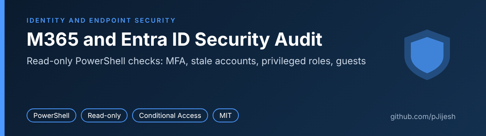
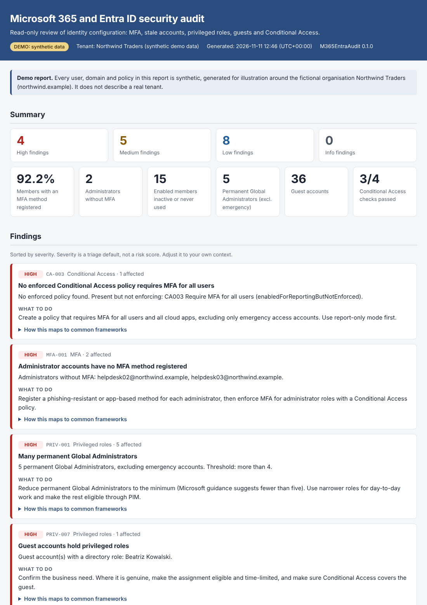

# M365 and Entra ID Security Audit



[](https://github.com/pJijesh/m365-entra-security-audit/actions/workflows/ci.yml)
[](LICENSE)
[](https://learn.microsoft.com/powershell/scripting/install/installing-powershell)

**Problem:** Most Microsoft 365 tenants drift. Accounts stop being used, guests are invited and forgotten, administrator roles accumulate, and Conditional Access policies are left in report-only mode. Checking this by clicking through several admin portals is slow, hard to repeat, and leaves no evidence a manager can read.

**For:** IT managers and small IT teams who run a Microsoft 365 tenant without a dedicated security team, and who need a repeatable, read-only health check they can explain to a board, an auditor or a customer.

**Demonstrates:** Microsoft Graph PowerShell SDK usage with least-privilege (read-only) scopes, a structured PowerShell 7 module with a separate data-access layer, Pester v5 tests that run without a tenant, static analysis and CI, and the translation of technical findings into plain-English actions.



The screenshot is the top of `docs/sample-report.html`, produced by `-DemoMode` from synthetic data for a fictional company, Northwind Traders. The full report is [docs/sample-report.html](docs/sample-report.html). Download it and open it in a browser, or generate your own with the demo command below.

## Quick start

Two minutes, with a tenant. You need PowerShell 7.2 or later and an account that can read the data (Global Reader is the simplest choice, see [docs/permissions.md](docs/permissions.md)).

```powershell
Install-Module Microsoft.Graph -Scope CurrentUser

Connect-MgGraph -Scopes 'User.Read.All','AuditLog.Read.All','RoleManagement.Read.Directory','Policy.Read.All','GroupMember.Read.All','LicenseAssignment.Read.All'

Import-Module ./src/M365EntraAudit/M365EntraAudit.psd1

Invoke-SecurityAudit -EmergencyAccount 'breakglass1@yourtenant.example','breakglass2@yourtenant.example'
```

`Get-AuditRequiredScope` returns the same six scopes, so `Connect-MgGraph -Scopes (Get-AuditRequiredScope)` is equivalent.

The audit writes an HTML report, one CSV per area, a findings CSV and a Conditional Access JSON export to `.\audit-output`.

No tenant? Run the same report from synthetic data. Nothing connects to Microsoft 365:

```powershell
Import-Module ./src/M365EntraAudit/M365EntraAudit.psd1
Invoke-SecurityAudit -DemoMode -OutputPath ./demo-output
```

## Commands

| Function | What it does |
| --- | --- |
| `Invoke-SecurityAudit` | Runs every area below and writes the HTML report, CSV files and JSON export. If one area fails, the others still run and the report says what was not assessed. |
| `Get-MfaCoverage` | Reports who has registered an MFA method: administrators without MFA, members without MFA, and users who rely only on SMS or voice. |
| `Get-StaleAccounts` | Finds enabled members with no recent sign-in, members who never signed in, and disabled accounts that still hold licences. |
| `Get-PrivilegedRoleHolders` | Lists directory role holders and how each role is held: permanent, time-bound, PIM-eligible, PIM-activated or through a group. Flags guests, disabled accounts and service principals with roles. |
| `Get-GuestUsers` | Reviews guest accounts by age, last sign-in and unaccepted invitations. |
| `Export-ConditionalAccessPolicies` | Exports policies to JSON and checks four common gaps: MFA for administrators, legacy authentication blocked, MFA for all users, MFA for guests. |
| `Get-AuditRequiredScope` | Returns the read-only Graph scopes the module needs, with `-Detailed` to see why each one is requested. |

Every command accepts `-DemoMode`. Thresholds such as `-InactiveDays` and `-MaxPermanentGlobalAdmins` are parameters. Use `Get-Help <command> -Full` for details. How to read each finding is in [docs/interpreting-results.md](docs/interpreting-results.md).

## Graph scopes

All six scopes are read-only. The test suite fails if a `ReadWrite` scope is added.

| Scope | Used for |
| --- | --- |
| `User.Read.All` | Account state, user type, licences, guest invitation state, role holder details. |
| `AuditLog.Read.All` | Sign-in activity and the MFA registration report. |
| `RoleManagement.Read.Directory` | Role definitions, assignments and PIM eligibility and schedules. |
| `Policy.Read.All` | Conditional Access policies. |
| `GroupMember.Read.All` | Members of groups that hold directory roles. |
| `LicenseAssignment.Read.All` | Licence names instead of IDs. Optional. |

The full reasoning, the Graph endpoint behind each call and the scopes that are deliberately not requested are in [docs/permissions.md](docs/permissions.md).

## Safety

- **Read-only.** The code calls only `Get-Mg*` cmdlets, and only from one file, `src/M365EntraAudit/Private/30-GraphData.ps1`. Tests fail if a write cmdlet, a write HTTP method or a `ReadWrite` scope appears anywhere in the source.
- **Nothing leaves your machine.** The module makes no network calls other than the Microsoft Graph reads you authorise. The report is a single HTML file with no scripts and no external resources. Output is written to a local folder and nowhere else.
- **Treat the output as sensitive.** Reports and exports describe your tenant, including user names and object IDs. Store and share them accordingly. The `.gitignore` in this repository excludes the default output folder.
- **Synthetic demo data.** `-DemoMode` uses invented people and the reserved domain `northwind.example`. It represents no real organisation.

## Repository map

```text
src/M365EntraAudit/
  M365EntraAudit.psd1        Module manifest
  M365EntraAudit.psm1        Loads Private, then Public
  Public/                    The seven exported commands
  Private/
    00-Constants.ps1         Scopes and high-privilege role IDs
    10-Helpers.ps1           CSV-safe output, date and connection helpers
    20-FindingCatalog.ps1    Finding text, severity and framework mapping
    30-GraphData.ps1         The only file that calls Microsoft Graph
    40-DemoData.ps1          Synthetic dataset for -DemoMode
    50-CaChecks.ps1          Conditional Access heuristics
    60-Report.ps1            Self-contained HTML report
tests/                       Pester v5 tests (no tenant needed)
tools/                       Sample report generator, screenshot capture, lint runner
docs/                        Permissions, interpreting results, testing status, sample report
.github/workflows/ci.yml     PSScriptAnalyzer and Pester on every push and pull request
```

## Limitations

- **Not yet run against a live tenant.** The Graph SDK cmdlet names and parameters were checked against Microsoft.Graph 2.41.2, and the logic is tested with mocked data, but the first run in your own tenant should be treated as a verification step. See [docs/testing-status.md](docs/testing-status.md) for exactly what was and was not run.
- **Conditional Access checks are heuristics.** They read policy settings. They do not simulate sign-ins, and they cannot tell whether Security defaults provide baseline MFA.
- **Registration is not enforcement.** A user with an MFA method registered may still never be prompted. Read the MFA results together with the Conditional Access checks.
- **Licence dependent.** Sign-in activity needs Microsoft Entra ID P1 or P2. PIM data needs P2 or Governance. The report says when data was unavailable.
- **The MFA registration report excludes disabled users.** This is documented Microsoft behaviour.
- **Severity is a triage default, not a risk score.** Framework mappings (Zero Trust, Cyber Essentials, CIS-style) are plain-English paraphrases, not certification claims.
- **Scope of review.** Device compliance, application consent, mailbox rules, external sharing and Defender configuration are out of scope.
- **Interactive sign-in.** The module is written for delegated sign-in. App-only authentication is untested.

## Roadmap

Planned, not promised. Order and timing change with other work.

- **Next:** Add HTML summary report; Add authentication methods check
- **Then:** Add app registration secret expiry check; Add privileged role eligibility review
- **Later:** Add comparison between two audit runs; Release v1.1

## Author

Built by Puliyappottammal Jijesh, an IT manager.

- LinkedIn: [linkedin.com/in/pjijesh](https://www.linkedin.com/in/pjijesh)
- GitHub: [pJijesh](https://github.com/pJijesh)

## Licence

Released under the [MIT Licence](LICENSE).
